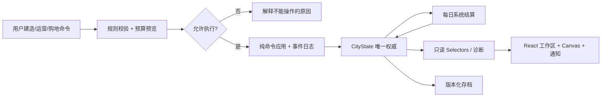

# 《我的迷你城市》重构版 — 技术架构与落地计划 v1.0

> 状态：设计方案；尚未实施。审查对象为 `我的迷你城市_v4.6.1_服务覆盖诊断修复版.html`，辅以用户提供的版本 6 城市 JSON 存档。
> 决策原则：**可测的模拟内核优先、最少依赖、数据安全、逐段迁移、可持续加入新建筑/玩法。** 不把一切都拆成微服务或插件平台。

## 1. 原型技术审查（证据与后果）

| 原型现状（已在代码中看到） | 后果 | 重构决策 |
|---|---|---|
| 业务、Canvas、DOM、声音、存档均在单个约 255 KB HTML 文件 | 不同职责相互影响，修财政可能破坏 UI / 车辆 | 分离模拟内核、内容、输入、渲染、UI、存档 |
| `stat()` 每次跨整张 `H×W` 世界扫描，同时计算工作、水电、服务、财政、幸福与覆盖 | 边界不清，调参不可归因；大型地图重算代价高 | 分阶段纯函数 + 脏区缓存 + 明确数值责任链 |
| `coverage()` 使用住宅和服务建筑的几何距离，随后乘总名额/总需求比 | 总容量充足却有远郊缺口，概念易混 | 按路网可达和容量逐片区分配服务 |
| `updateCars(dt)` 每帧调用 `stat()`；车辆路径、堵塞统计一起更新 | 表现层与经营结果相互牵制、性能成本随地图增长 | 城市交通“需求/分配”与可视车辆分开，来源相同 |
| `undoSnapshot()` 深拷贝整个世界状态；`save()` 将整个世界 JSON 写入 localStorage | 每操作复制巨大存档，增长后卡顿或超配额 | 命令历史 + 受影响地块差异；IndexedDB 增量保存 |
| `modePrediction()` 临时修改地图后重新跑 `stat()` 再恢复 | 预测中短暂改变权威状态，出现异常易留下脏数据 | 纯 `simulateChange(base, command)` 沙盒预测，不改真实城市 |
| 旧版迁移在 `rehydrate()` 混合坐标、类型兼容与 UI 状态 | 升级时难定位风险，迁移难测 | 独立版本化迁移流水线 + 预览报告 |
| `modalOpen` 同时影响模拟暂停，音频同步与其它状态另处理 | 打开某类面板会意外暂停游戏/音乐 | 显式 `simulationPaused`、`musicEnabled` 与 `dialogKind` |
| 存在 `?test` 的测试入口，但没有独立、完整的模拟回归框架 | 测试依赖浏览器过程，不易重复比较版本 | 固定种子单元/属性/黄金存档测试 + 浏览器 E2E |

上表是**代码审查结果**，不是对新架构已完成的实现或性能承诺。

## 2. 最小可维护技术栈

- **TypeScript + Vite + React**：React 负责工作区、设置、诊断、日志等界面；浏览器 Canvas 2D 负责地图、建筑和车辆绘制。暂不引入大型游戏引擎。
- **纯 TypeScript 模拟域**：完全不依赖 React、Canvas、DOM、音频、localStorage，可在 Node 环境测试。
- **Vitest**：规则测试、固定种子长周期测试；**Playwright**：交互、视图、缩放、导入导出与 Toast。
- **IndexedDB**：游戏档案和地图块；JSON 文件导入导出；localStorage 仅用于音量、键位等轻量偏好。数据库封装为 `SaveRepository`，避免把浏览器 API 扩散到规则中。
- 先使用单一前端应用和明确的 `src` 模块目录，不为“未来会有很多插件”提前引入 monorepo、Redux 或消息总线。

推荐代码布局：

```text
src/
  sim/
    state/        # CityState、Clock、PRNG、类型
    commands/     # 建造、升级、拆除、购地、运营、政策及验证
    systems/      # 人口、就业、财政、服务、水电、交通、环境、剧情
    selectors/    # 财政报告、缺口定位、建筑详情；纯读操作
    testing/      # 场景工厂、固定种子测试夹具
  content/
    buildings.ts  # 数据配置、规则声明、效果参数
    chapters.ts   # 剧情条件与分支
    events.ts     # 限时事件配置
    scenarios.ts  # 模式和关卡数据
  world/
    terrain.ts    # 地形噪声及确定性生成
    chunks.ts     # 稀疏地图、坐标、土地块
    graph.ts      # 路网、连通和路径查找
  render/
    canvas.ts     # 可见块绘制、拾取、镜头、图层
    effects.ts    # 车辆/活动视觉效果（只读）
  ui/
    hud/ workspace/ notifications/ inspector/ overlays/
  persistence/
    repository.ts migrations.ts import-export.ts
  audio/
    audio-controller.ts
  app/
    session.ts    # 驱动模拟 tick、用户命令与 UI 更新
```

## 3. 状态流与唯一事实来源



禁止 UI 直接修改游戏状态。禁止 Canvas 动画决定人口和财政。所有操作通过已定义命令 `dispatch(command)`；系统产生带编号的业务事件，供日志、Toast 和回放使用。

核心契约示意（说明结构，不是已实现 API）：

```ts
type WorldPoint = { x: number; y: number }; // 世界坐标，允许负数

type CityCommand =
  | { type: 'Build'; at: WorldPoint; buildingId: string }
  | { type: 'Demolish'; at: WorldPoint }
  | { type: 'SetOperation'; id: string; level: 'normal' | 'reduced' | 'closed' }
  | { type: 'BuyParcel'; x: number; y: number }
  | { type: 'SetTax'; percentage: number }
  | { type: 'ChoosePolicy'; policyId: string };

type CommandResult =
  | { ok: true; next: CityState; events: CityEvent[]; changes: ChangeSet }
  | { ok: false; reasonCode: string; message: string };

type DailyLedger = {
  day: number;
  openingBalance: number;
  entries: Array<{ category: string; amount: number; sourceId?: string }>;
  closingBalance: number;
};
```

金额统一整数货币单位；跨日计算可使用高精度中间值，结算时按明确规则取整。保证账本收支能加总到结余，**不允许 UI 使用另一条公式“估算一个不同的结余”**。

## 4. 每日结算：固定顺序、纯函数、可重放

建议每一游戏日执行如下阶段：

1. 获取日初快照、政策和设施运营状态；处理到期议题/活动。
2. 更新网络：仅重新计算变动区域相关的路网/水电连接与可达性缓存。
3. 根据日初人口与住房/岗位，分配劳动人口，得出企业实际产能与运输需求。
4. 按需分配学校、诊所等公共服务名额，结合道路可达和单座容量；更新污染和通勤结果。
5. 计算居民满意度与人口迁移量（有上限）；迁移结果按定义在当日或次日参与税收，避免环状依赖。
6. 按同一份计算结果生成**正式财政流水**，结算当日余额并处理贷款。
7. 评价剧情、委托和事件状态，发放一次性奖励并发出业务事件。
8. 生成当天可回放摘要、更新预测缓存，并持久化必要状态。

**规则选择**：当日产业与税收采用日初人口；当天新增人口从次日开始纳入税基。预测的“下一天净额”必须调用相同计算路径的只读模拟，而不是直接修改真实状态。

### 性能

`world` 和 `network` 有自己的版本号：只有道路/桥隧改变才使交通图失效；只有设施开关、人口或道路可达变动才重新分配对应服务。相邻影响用空间索引缓存，禁止每帧对全地图做 O(W×H) 统计。前期直接使用简单结构，性能瓶颈出现后再优化成更复杂的索引。

## 5. 世界坐标、地图、土地市场

- 世界采用**永久稳定的整数坐标**，原点为初始城市参考点；不通过移动全世界数组来支持向西/向北扩张。
- 内部储存建议 16×16 稀疏 Chunk；地块购买单位保留 6×6，二者独立（允许地块横跨 Chunk）。区块键包含有符号坐标；用 floor division 正确处理负坐标。
- 未修改地形由 `seed + worldPoint` 确定性生成，不因镜头移动或扩建重抽；已建造/改变的地块保存为覆盖数据（overrides）。
- 地块可购买条件从已拥有地块的四向共享边界推导，允许向八方向逐步发展；对角地块不能凭仅接触角落跳跃购买，除非有明确特殊政策。
- “购买土地”和“道路连通”是不同问题。购买成功并不自动让新区获得交通、水电或居民。
- 镜头只决定显示和拾取，不改变模拟位置；缩放保持 X/Y 同一比例，屏幕边缘可显示可视但不可建设的自然背景。

## 6. 网络与交通系统边界

`RoadGraph` 是可复用的权威网络。道路、桥梁、隧道同属连接边，但有成本、速度、容量与施工条件。服务可达性可使用道路距离或规划后的步行规则；不要求每座建筑都必须紧贴市政厅同一条路才算存在，但需要明确服务和货运的网络依赖。

首版交通采用**片区级需求流 + 路段容量**生成拥堵与通勤指标；可视车辆根据需求流抽样行驶，遵守真实同一套图和路口规则，但车辆数量不会决定交通财政或居民满意度。

不在第一阶段实现物理级车辆避障、立体路口、连续交通仿真。针对两车迎面直行、跟车、左转、红灯、无出口路口、断路和桥隧连接建立可重复的微场景测试。

## 7. 公共服务的确定性分配

服务计算输入是：各居住片区**实际居民**和某类服务需求、每个设施的有效容量、运营状态以及路网距离/时间。输出：服务人数、未服务人数、设施负载、片区可达性与满意度影响。

分配策略首版可以使用“按距离从近到远分配需求”并固定同距的排序规则，确保总已服务需求不超过供给也不超过人口需求。后续可替换优化器，但不得影响 UI 口径。

明确两个独立指标：

- `capacityRatio = totalActiveSlots / totalDemand`（城市供需宏观充足度）
- `servedRatio = actuallyServedPeople / totalDemand`（真正满足的居民比例）

地图图层用 `unservedPeople` 找到具体街区，而不是用空置住房容量代替居民。运营设施的预演只使用**模拟副本**，不能修改权威城市状态再恢复。

## 8. 建筑/剧情/事件的数据扩展边界

首版不需要用户安装插件；使用**静态配置表 + 少量受控规则类型**。每条建筑定义中包含 `id`、展示信息、占地格、地形约束、经济主体、成本、就业/住宅/服务/供需效果、路网依赖和可用运营模式。不要让建筑配置携带随意执行的 JS 字符串。

剧情由条件表达式/谓词注册表与状态机推进；提供明确的完成条件、截止规则、奖励与持久效果。游戏事件与音效由 CityEvent 派生，不允许在业务规则中直接调用 DOM 弹窗或播放音乐。

在添加新建筑前回答：影响哪个系统？与什么形成取舍？失败时如何诊断？是否需要迁移旧存档？对应测试场景是什么？

## 9. UI、输入、Toast 与声音

- Canvas 占据整屏可用空间，地图平移、缩放和建造命中均使用唯一 `CameraTransform`（world ↔ screen）。
- 默认右侧导航，浮动工作面板从右侧打开，可拖动/收起；工具、城市、财政、运营、消息、土地/管理、设置各司其职。
- 输入模式显式化（检查、建造、拆除、平移），按住空格临时平移；道路拖动仍铺路。一次拖动视为一个事务。
- 普通 Toast 是固定宽高的短反馈，重要活动以小型限时卡片出现，连续消息由队列或最新消息替换；位置不随文本变化跳动。
- `Pause` 明确决定模拟时钟；活动不改变 Pause。音乐遵循玩家开关、用户主动暂停和浏览器后台策略；弹出信息卡不暂停音乐。
- UI 始终展示来源同一套 Selector 的指标，避免悬停与面板结果不同。

## 10. 撤销、存档和旧版迁移

### 撤销

以操作命令的 `ChangeSet` 存储逆操作和资金变化，不再拷贝整张地图。拖动建路是一个事务。日结已经发生后默认不允许撤销跨日建设（避免回滚人口、贷款、事件）；在 60 秒窗口或最多 10 步内，满足“同一天”约束可撤销。提供解释提示。

### 存档

- 当前推荐 IndexedDB 存档，分离城市元数据、世界块、事件日志与存档版本。保存过程必须原子化提交，避免只写一半。
- 支持 3 个以上命名存档槽、自动存档、手动存档、导出 JSON（可选压缩）、导入前验证与预览。
- 存档包含随机种子、世界坐标、地形覆盖、建筑运行模式、政策、人口、货币、剧情、金融流水和版本；**不保存**可重建的渲染缓存与车辆动画帧状态。
- 客户端新版本不能直接改写旧存档；迁移后产生新的存档 ID，老存档保留供回退。

### 迁移 v4.6.1 的真实档案

已知原始 JSON 格式：`version: 6`、`layout: {W,H,OX,OY}`、`world[y][x]` 和 `state`。转换时，新世界坐标以旧参考原点为中心：`newX = oldX - OX`，`newY = oldY - OY`；桥隧、道路、建筑 `level/opMode`、土地所有权、剧情政策等要逐项映射。

可能需要特殊兼容：旧版将河/山既编码为 `ground` 又编码为 `type`；旧版土地块键与原点有关；旧版静态地形不一定与新的随机种子一致。迁移时优先保留已有地形与建筑，而不是强制套用新地图。

**迁移报告**必须包含：迁移建筑数、未识别建筑、道路连通数、原始/新人口与余额、旧/新预测日净额差值、失效政策与补救方式。经济模型语义改变时，绝不能谎称存档和新版本财政完全相同；只有玩家确认才完成迁移。

## 11. 测试体系与质量门槛

### 规则不变量（自动化）

1. 财政流水的 `closingBalance - openingBalance === sum(entries)`，无重算/漏算；建造与购地是一次性成本。
2. 税率变化在其他状态固定时，不会立刻让居民税额反向变化。
3. `0 <= servedDemand <= min(totalDemand, activeCapacity)`；停运某设施不会增加服务总容量。
4. 未购买地块不能建造；正负坐标都可扩建；地形决定建造是否合法。
5. 已建桥/隧与道路图一致；拆除后恢复地形且对应通道断开。
6. 设施运营切换、购地、建造、撤销后，存档往返结果一致。
7. 相同种子、初始状态和命令序列生成相同的日结与剧情结果。
8. Toast 和城市活动不会改变模拟暂停状态；手动暂停不产生一日结算。

### 场景回归

- 早期：初始小镇 1–30 天；有路/没路、水电缺口、第一章剧情。
- 中期：跨河新区、同时有公交和产业、消费不足、某片区没有诊所。
- 成熟城市：导入当前用户真实档（484 人、学校与诊所密集），验证**计算正确、性能和可诊断性**，不硬性要求自动盈利。
- 恢复：连续亏损 30 天后关闭冗余设施、规划新道路，应该出现可解释的改善趋势。
- 地图扩张：向四向及角落购地至少数十块，旧城区坐标、地形种子、存档无漂移。

### 初拟性能预算（需实测校准）

- 桌面 1080p 普通操作地图保持流畅，默认目标 60fps，不卡在每日结算节点。
- 10,000 已加载地块/数百建筑场景，每次日结优先控制在 50ms 左右；达不到时应先 profile 再引入 Web Worker。
- 大城市连续 365 游戏日固定种子模拟，不出现 NaN、负容量、无效余额、重复事件结算。
- 保存异常、IndexedDB 配额与旧档迁移失败都要可恢复，不得破坏原档。

上述预算只是**验收提案**，不是当前已完成性能测试结果。

## 12. 落地顺序：纵向切片，不搞‘先搭半年架构’

| 阶段 | 做什么 | 完成门槛 |
|---|---|---|
| **A. 冻结/测量原型** | 备份 v4.6.1；收集真实存档与问题；确认玩法基线、规则争议、关键数值口径 | 有可运行旧版、固定回归档、设计决策记录 |
| **B. 模拟内核最小切片** | TS 状态、地形/道路/建造、日结财政、简单人口、存档 | CLI/单测可重放 30 天；账本可核对；无 DOM 依赖 |
| **C. 第一段完整可玩闭环** | Canvas 全屏 + 右侧浮层 + 放置/撤销 + 学校/诊所覆盖 + 财政诊断 + 第一章故事 | 真人从零开始能完成“建造—观察—诊断—修复—推进剧情” |
| **D. 迁移与压力回归** | v6 JSON 导入、熟城诊断、四向购地、桥隧、事件、汽车表现 | 真实档报告透明、坐标无漂移、长期运行稳定 |
| **E. 按内容契约扩展** | 建筑目录、后续章节、事件、场景/挑战模式 | 每个新增内容有明确取舍、自动化规则测试与存档兼容 |

### 现在不应该开始的工作

无条件增加 30 种建筑、全面交通物理、个体居民 AI、地铁高架、服务端账号、微服务、内容插件市场、在线地图共享。它们都应等待核心闭环通过可玩性和性能验收。

## 13. 决策记录（ADR 摘要）

- ADR-001：继续用浏览器单机版；模拟核必须不依赖 UI。
- ADR-002：财政、市政账户与私人经济明确分账；同一账本用于显示和结算。
- ADR-003：世界坐标恒定，可无限方向扩张；按需分块，不预生成无限地图。
- ADR-004：服务按居民、容量和可达性分配，而非只看几何覆盖率。
- ADR-005：交通宏观需求决定经营结果，可视车辆只表现它。
- ADR-006：剧情、建筑、事件用配置 + 受控效果类型扩展，先不做运行时插件平台。
- ADR-007：命令历史的变化集用于撤销，跨日结算不能随意回滚。
- ADR-008：旧存档不可直接覆盖迁移；向用户显示新的财政规则带来的变化。
- ADR-009：UI 地图优先，所有诊断有空间定位/可解释来源；非关键 Toast 不阻断游戏。

## 14. 外部设计参考（非代码依赖）

- Colossal Order/Paradox 对 *Cities: Skylines II* 经济系统的设计复盘，重点是模型透明与玩家可控：https://www.paradoxinteractive.com/games/cities-skylines-ii/news/dev-diary-economy-part-one
- *OpenTTD* 说明道路连接及运输服务与城镇增长的关系：https://wiki.openttd.org/en/Manual/Towns

参考仅用于设计取舍；本项目在实现复杂度、目标用户、规则参数上独立决策。